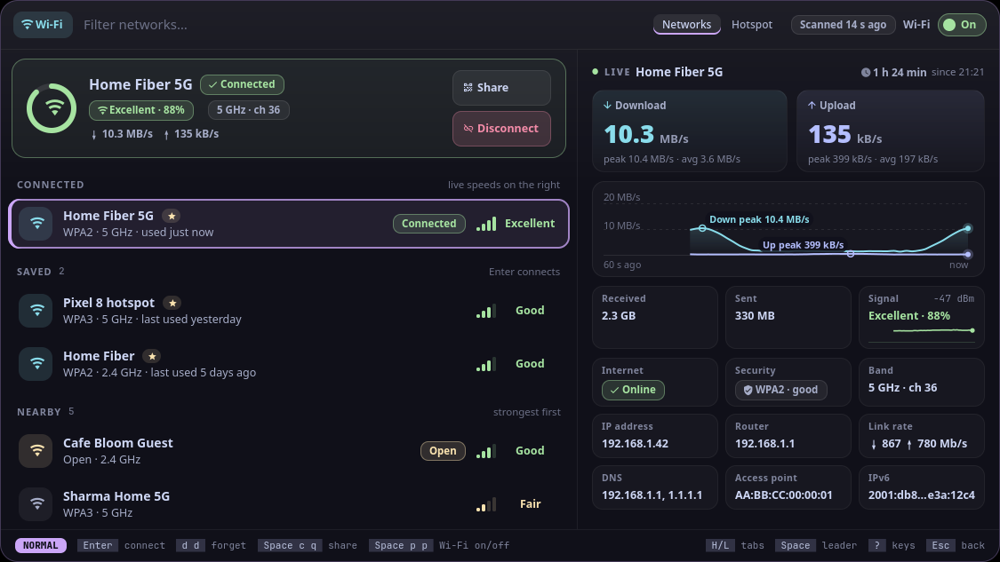
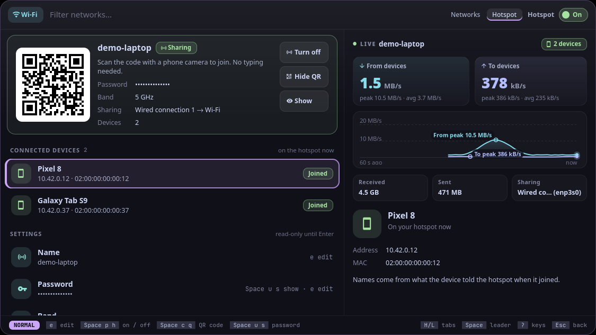

<p align="center">
  <picture>
    <source media="(prefers-color-scheme: dark)" srcset="assets/banner-dark.svg">
    <source media="(prefers-color-scheme: light)" srcset="assets/banner-light.svg">
    
  </picture>
</p>

<!-- identity -->
<p align="center">
  <b>यथा न तोयतो भिन्नास्तरङ्गाः फेनबुद्बुदाः ।<br>
  आत्मनो न तथा भिन्नं विश्वमात्मविनिर्गतम् ॥</b><br>
  <i>As waves, foam and bubbles are not apart from water, the world is not apart from the self it rose from.</i><br>
  <sub>Aṣṭāvakra Gītā 2.4</sub>
</p>
<!-- /identity -->

<p align="center">
  <b>Wi-Fi: the network you're on at a glance, signal in bars and words, connect with the password typed inline and see each step, share by QR code; and a hotspot tab (vayu-hotspot).</b><br>
  Wi‑Fi and the hotspot. A tool for <a href="https://github.com/Theyashsawarkar/vyom">Vyom</a>, keyboard-driven panels for Wayland.
</p>

<p align="center">
  <a href="https://github.com/Theyashsawarkar/tarang/actions/workflows/ci.yml"></a>
  <a href="https://github.com/Theyashsawarkar/tarang/releases"></a>
  <a href="LICENSE"></a>
  <a href="https://github.com/Theyashsawarkar/vyom"></a>
  
  
</p>

<p align="center">
  
</p>
<p align="center">
  
</p>
<p align="center"><sub>Screenshots use made-up demo networks.</sub></p>

> *Tarang* (तरंग) is Sanskrit for "wave": the radio waves your Wi‑Fi and hotspot ride on.

tarang is wi‑Fi and the hotspot for [Vyom](https://github.com/Theyashsawarkar/vyom): one keyboard-driven panel that opens instantly, with live data, a preview and a key for everything. It runs on any compositor with the layer-shell protocol (sway, Hyprland, river, niri, Wayfire, labwc…). In [Vayu](https://github.com/Theyashsawarkar/vayu), the desktop it was built for, it replaces networkmanager_dmenu (wifi-picker.py).

## Contents

- [Features](#features)
- [Install](#install)
- [Usage](#usage)
- [Configuration](#configuration)
- [Troubleshooting](#troubleshooting)
- [The Vyom family](#the-vyom-family)
- [Contributing](#contributing)
- [License](#license)

## Features

- **The network you're on, at a glance**: a card at the top with a signal ring, band and channel, your download and upload right now, and its **Share** (`Space c q`) and **Disconnect** (`Space c d`) buttons. It's also the first row of the list, under **Connected**. Not connected, the card says why: Wi‑Fi off, on Ethernet, NetworkManager not running, no Wi‑Fi card.
- **Live speeds on the right**: with the network you're on picked (it is when the panel opens), the right side shows download and upload as big numbers with their peak and average, **the last minute as a graph** (peaks marked), data received and sent, how long you've been connected (and since when), the signal with its own line and dBm, and every fact in one place: internet (Online, Limited, Sign in, No internet), security, band and channel, IP address, router, link rate (both ways, from `iw` when it's there), DNS, access point and IPv6. It moves once a second, and only while the panel is open: tarang reads the card's own byte counters (`/sys/class/net`) and signal (`/proc/net/wireless`), so it never sends anything to measure (no speed test, no ping).
- **Signal as bars and a word** (Excellent, Good, Fair, Weak in green, green, yellow, red), saved networks starred, then nearby ones, strongest first. Open networks get a yellow **Open** chip, WEP/WPA1 a red one. Scanning shows in the top bar ("Scanning…", then "Scanned 8 s ago"); `r` rescans.
- `Enter` connects; a secured network you haven't joined asks for its **password right in the search box** (hidden; `Ctrl+S` shows it), and nothing is sent until you press `Enter`.
- **Connecting shows its steps** (Associating, Authenticating, Getting an address), read from NetworkManager as they happen. When it fails it says **why** in red: wrong password (and asks again), out of range, no address from the router, a network that needs a user name (WPA Enterprise), a password that's too short.
- Another network picked: its signal and **how it compares with the one you're on** ("17 points weaker than Home Fiber 5G"), security as a chip (WPA3 strong, WPA2 good, Open with a warning that anyone nearby can read unencrypted traffic), band, channel and frequency, top speed, saved or new, metered, access point, and **Connect** / **Forget** in red: `dd` asks first (`y` forgets), since it can't be undone.
- **Share** (`Space c q`): a QR code phones scan to join the network you're on (needs qrencode; without it, the password is shown instead). Only when you ask; the password stays hidden until `Space u s`.
- A **Hotspot tab** (with Vayu's `vayu-hotspot`, or any command with its `status --json` / `on` / `off` interface): a QR code to join, the name, the password (hidden until `Space u s`), the band and what it shares, the devices connected right now, the hotspot's own traffic live on the right (from and to its devices, the last minute, totals), and `Space p h` (or the switch) to turn it on or off. Name, password and band are settings, read-only until you press `e` or `Enter` on one.
- A Wi‑Fi on/off switch in the top bar (`Space p p`); on the Hotspot tab it's the hotspot's. With Wi‑Fi off the list has one row, **Wi‑Fi is off**: `Enter` turns it on.
- **Vim keys** (Vyom 0.7): NORMAL and INSERT modes, counts, `Space` as the leader with a which-key strip, `?` for every key and `Space Space` for a palette of every action.
- Keyboard first: every action has a key, shown on its button and in the footer; the mouse works too.
- Never freezes the panel: slow commands run in the background.

## Install

### Requirements

- [Vyom](https://github.com/Theyashsawarkar/vyom) 0.7 or newer (Python 3.11+, PyGObject, GTK 4, [gtk4-layer-shell](https://github.com/wmww/gtk4-layer-shell), a Nerd Font)
- `nmcli`
- optional: qrencode (QR codes to share a network or join the hotspot)
- optional: iw (the link rate both ways in the live view)

### Install

```sh
git clone https://github.com/Theyashsawarkar/tarang ~/.local/share/vyom/plugins/tarang
vyom reload           # pick it up (or log out and in)
vyom tarang            # open it; run it again to close
```

Give it a key in your compositor, e.g. sway:

```sh
bindsym $mod+<key> exec vyom tarang
```

### Update and uninstall

```sh
git -C ~/.local/share/vyom/plugins/tarang pull && vyom reload     # update
rm -rf ~/.local/share/vyom/plugins/tarang && vyom reload          # uninstall
```

## Usage

Open it with `vyom tarang` (or your key; `vyom tarang hotspot` opens the Hotspot tab). It opens in NORMAL mode, where every letter is a key and typing changes nothing: `j` / `k` move, `H` / `L` switch tabs, `Enter` connects, `dd` forgets (it asks), `/` types a filter (INSERT mode; `Esc` goes back). A password or a hotspot field puts the search box in INSERT mode by itself: `Enter` submits, `Esc` cancels, `Ctrl+S` shows what you type. `Space` is the leader: wait a moment after it and a strip shows what comes next.

<!-- KEYS (generated by scripts/keybinds.py from tarang/vim.py) -->

Vyom's vim keys work too: `?` and `Space ?` list every key, `Space Space` is the palette, `q` closes, `Esc` steps back, `Space u f` is fullscreen, `Space r` refreshes, `j` / `k` move, `gg` / `G` jump, `/` searches.

**Normal mode, Networks (where it opens; `/` types a filter)**

| Key | Action |
|---|---|
| `Enter` | Connect to the selected network (asks for its password if needed) |
| `d d` | Forget the selected saved network (y confirms: its password goes too) |
| `r` | Rescan for networks now |

**Normal mode, Hotspot**

| Key | Action |
|---|---|
| `Enter` | Edit the selected hotspot setting (the band: switch it) |
| `e` | Edit the selected hotspot setting |

**Both modes**

| Key | Action |
|---|---|
| `Ctrl+s` | Show or hide the password you type (works while typing) |

**Leader (Space)**

| Key | Action |
|---|---|
| `Space p p` | Toggle Wi-Fi on or off |
| `Space p h` | Toggle the hotspot on or off |
| `Space c d` | Disconnect from the current network |
| `Space c q` | Show the current network as a QR code (to share it) |
| `Space u s` | Toggle the passwords (show or hide them) |
| `Space y p` | Copy the network's password (the hotspot's on its tab) |
| `Space y s` | Copy the network's name (the hotspot's on its tab) |
| `Space d d` | Forget the selected saved network (y confirms) |

**Leader (Space), Hotspot**

| Key | Action |
|---|---|
| `Space c q` | Toggle the hotspot's QR code |

Keys that moved in this release still say where they went:
`Ctrl+f` → `d d`.

<!-- END KEYS -->

## Configuration

Everything is optional, in `~/.config/vyom/config.toml` under `[plugin.tarang]`:

| Setting | Default | What it does |
|---|---|---|
| `hotspot_command` | vayu-hotspot | The hotspot command (the tab hides without it) |

Run `vyom reload` after editing.

## Troubleshooting

- **Nothing opens.** `vyom list` shows every installed tool, and why one is skipped (a missing requirement, or a Vyom that's too old).
- **It opened, then something failed.** Look for a `Traceback` in the daemon's log, `journalctl --user -u vyom -u vyom-daemon -b` (without systemd: `~/.local/state/vyom/daemon.log`), and [open an issue](https://github.com/Theyashsawarkar/tarang/issues/new/choose) with it.
- **No blur or rounded corners.** That's the compositor: on SwayFX, add `layer_effects "vyom" { blur enable; corner_radius 20; shadows enable }`.

## The Vyom family

Each tool is its own repository, so you install only the ones you want:

| Tool | | What it does |
|---|---|---|
| [dvara](https://github.com/Theyashsawarkar/dvara) | द्वार, gateway | The app launcher |
| [ganit](https://github.com/Theyashsawarkar/ganit) | गणित, mathematics | The calculator and converter |
| [smriti](https://github.com/Theyashsawarkar/smriti) | स्मृति, memory | Clipboard history |
| [bhava](https://github.com/Theyashsawarkar/bhava) | भाव, feeling, emotion | The emoji picker |
| [tarang](https://github.com/Theyashsawarkar/tarang) (this one) | तरंग, wave | Wi‑Fi and the hotspot |
| [setu](https://github.com/Theyashsawarkar/setu) | सेतु, bridge | Bluetooth |
| [doot](https://github.com/Theyashsawarkar/doot) | दूत, messenger | Your phone, through KDE Connect |
| [patra](https://github.com/Theyashsawarkar/patra) | पात्र, vessel | Docker containers |
| [akashvani](https://github.com/Theyashsawarkar/akashvani) | आकाशवाणी, voice from the sky | Notifications |
| [raga](https://github.com/Theyashsawarkar/raga) | राग, melody | YouTube music and video |
| [mudra](https://github.com/Theyashsawarkar/mudra) | मुद्रा, gesture | Keybinding search |
| [urja](https://github.com/Theyashsawarkar/urja) | ऊर्जा, energy | The battery at a glance |
| [vishram](https://github.com/Theyashsawarkar/vishram) | विश्राम, rest | The power menu |
| [kendra](https://github.com/Theyashsawarkar/kendra) | केन्द्र, centre | Quick settings |

## Contributing

Bug reports, ideas and pull requests are welcome: see [CONTRIBUTING.md](CONTRIBUTING.md) for the development setup and the few rules every tool follows, and [CHANGELOG.md](CHANGELOG.md) for what changed in each release. Please report security issues privately ([SECURITY.md](SECURITY.md)).

## License

[MIT](LICENSE).
